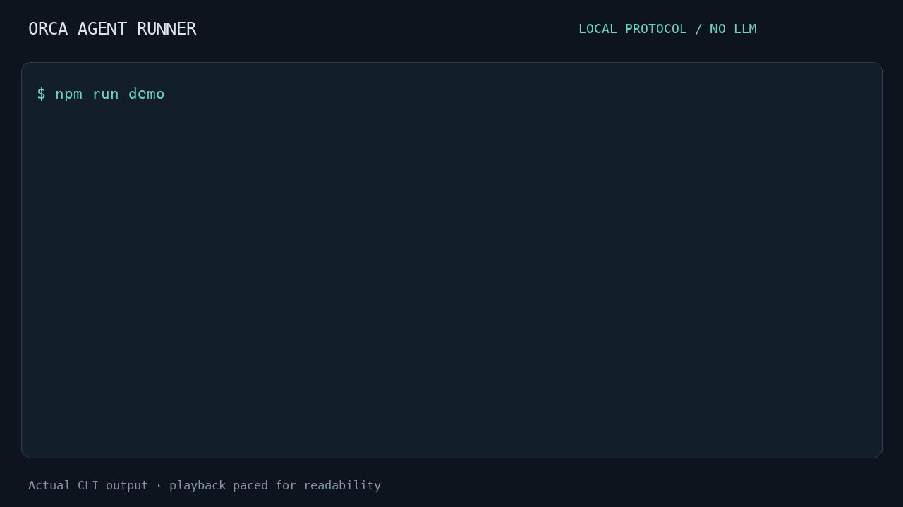

# orca-agent-runner



[](https://github.com/VictorPimentaDev/orca-agent-runner/actions/workflows/ci.yml)
[](package.json)
[](LICENSE)
[](https://github.com/VictorPimentaDev/orca-agent-runner/issues?q=is%3Aissue+is%3Aopen+label%3A%22good+first+issue%22)

**Give a coding agent a spec, an isolated worktree, and a completion contract.**

A small TypeScript CLI for the plumbing around a coding agent: read a spec, launch
an explicit worker command, collect a report ending in `FIM`, and close only the
idle sessions created by that run. Bring your own noninteractive coding agent.

[Quick start](#quick-start) · [Contributing](CONTRIBUTING.md) ·
[Orca adapter contract](docs/orca-adapter.md) · [Português](#português)

## Quick start

Node.js 22+ and Git. Run directly from GitHub; no global install:

```bash
npx --yes --package=git+https://github.com/VictorPimentaDev/orca-agent-runner.git oar --help
```

This installs from this repository, **not an npm registry release**. While the
repo is private, Git needs an account with read access. The `prepare` script builds
the CLI during installation. After review and publication the same URL works
without repository credentials. Never put tokens in command examples or URLs.

From a clean repository with a committed `SPEC.md`:

```bash
npx --yes --package=git+https://github.com/VictorPimentaDev/orca-agent-runner.git \
  oar run --repo . --spec SPEC.md --task implement --dry-run
```

A dry-run checks the spec and repository without creating worktrees or launching
workers. Remove `--dry-run` and provide your agent command after `--` to execute:

```bash
oar run --repo ~/projects/acme --spec ~/projects/acme/SPEC.md \
  --task implement -- node /path/to/your-agent-entrypoint.mjs
```

Here `oar` is an installed bin (`npm link` from a checkout also works); the full
`npx --package=… oar` prefix can replace it. Arguments after `--` are passed literally,
without shell expansion. The repository must have a commit and a clean working tree.

## The completion contract

```text
SPEC.md → isolated Git worktree → worker command → RESULT.md → owned idle cleanup
```

The worker receives the spec on stdin plus `OAR_TASK`, `OAR_SPEC_PATH`,
`OAR_RESULT_PATH` and `OAR_RUN_ID`. It must exit zero and write a nonempty report
whose last line is exactly `FIM`. Missing, stale, oversized or symlink reports are
rejected. Reports and logs stay outside the source checkout for review.

```text
# Result

Implemented input validation. Unit tests pass.
Not checked: external service integration.

FIM
```

Tasks run sequentially in independent worktrees from the same HEAD. There is no
automatic sharing of edits or merging between tasks. `FIM` verifies the completion
protocol; it does not certify the quality of the work.

## Replay the demo

The GIF above comes from an actual local run with assertions. It uses the clearly
labeled mock worker: **no coding implementation or LLM call is being claimed**.
Playback is paced for readability. [Download the asciinema cast](assets/demo.cast),
or replay it with `asciinema play assets/demo.cast`.

```bash
npm ci
npm run demo
```

The demo creates its own disposable repository, checks a dry-run and a real fixture
run, verifies the report/manifest/cleanup, then removes only that temporary fixture.
Git uses your configured identity. Normal runner executions preserve worktrees.
To regenerate the GIF/cast, install Python Pillow and run `python scripts/render-demo.py`
after `npm run build`.

## Scope and trust

The included adapter runs local subprocesses, without an interactive PTY. It does
not control the Orca app. The [adapter interface](docs/orca-adapter.md) is the extension
point for Orca terminals or another execution environment.

Workers inherit your OS permissions and environment. A worktree is file isolation,
not a security sandbox. Use trusted commands. There is no timeout, crash recovery,
distributed scheduler or dependency graph yet. Local cleanup works within the running
process; a new `oar cleanup` process does not recover or close external sessions.

## Contribute

Start with [CONTRIBUTING.md](CONTRIBUTING.md) and the
[good first issues](https://github.com/VictorPimentaDev/orca-agent-runner/issues?q=is%3Aissue+is%3Aopen+label%3A%22good+first+issue%22).
Small changes with a reproducible case are welcome. CI covers real temporary Git
repositories and controlled worker processes; it does not call an external LLM.

Social preview: [1280×640 card](assets/social-preview.png), ready to upload after
public review. GitHub does not offer first-time social-preview upload for a new private repo.

## Português

O fluxo é simples: **intake → gestor → worker → result → cleanup**. A especificação
entra como arquivo, cada tarefa ganha uma worktree e o resultado fica separado do
checkout original. O runner organiza a execução; quem implementa o trabalho é o
comando de agente que você escolher.

O adaptador incluído executa subprocessos locais sem shell e sem PTY interativo.
Ele não controla o aplicativo Orca. A interface permite acrescentar um adaptador
para terminais do Orca ou outro ambiente, sem fixar caminhos, contas ou IDs de máquina.

## Instalar e experimentar

Node.js 22+ e Git instalado. O desenvolvimento e o CI usam Node.js 24.

```bash
npm ci
npm run build
node dist/cli.js --help
node dist/cli.js run --repo . --spec examples/SPEC.md --task demo --dry-run
```

O dry-run lê a SPEC e valida o repositório, mas não cria arquivos, worktrees ou
processos de worker. O repositório precisa ter um commit e estar limpo, inclusive
sem arquivos não rastreados. O runner não faz stash nem commit por você.

Os bins `oar` e `orca-agent-runner` são disponibilizados ao instalar o pacote.
Para usá-los a partir deste checkout:

```bash
npm link
oar intake --spec examples/SPEC.md
```

### Demonstração do protocolo

Com o checkout limpo, este comando executa o fixture local incluído:

```bash
node dist/cli.js run --repo . --spec examples/SPEC.md \
  --task demo -- node examples/mock-worker.mjs
```

O mock grava um relatório que diz explicitamente que **nenhuma implementação foi
realizada**. Isso demonstra criação de worktree, passagem da tarefa, coleta de
resultado e limpeza do subprocesso. Não é uma demonstração de capacidade de um
agente de programação e não precisa de token ou provedor de IA.

## Executar um agente

Configure um comando que possa rodar sem interação e que finalize com um código
de saída. Os argumentos depois de `--` são passados literalmente, sem expansão
de shell. Um exemplo com caminhos fictícios:

```bash
oar run --repo ~/projects/acme --spec ~/projects/acme/SPEC.md \
  --task implement --task verify -- node /path/to/your-agent-entrypoint.mjs
```

Cada tarefa recebe a mesma SPEC e seu identificador. O conteúdo da especificação
deve explicar o trabalho de cada tarefa. Os workers rodam **sequencialmente**, mas
em worktrees independentes criadas a partir do HEAD do repositório original.
`verify` não recebe automaticamente as alterações de `implement`: resultados e
dependências entre tarefas precisam de coordenação explícita. Não há merge automático.

| Entrada do worker | Significado |
| --- | --- |
| stdin | Conteúdo da SPEC |
| `OAR_TASK` | Identificador da tarefa atual |
| `OAR_SPEC_PATH` | Cópia da SPEC da execução |
| `OAR_RESULT_PATH` | Caminho onde gravar `RESULT.md` |
| `OAR_RUN_ID` | Identificador da execução |
| diretório atual | Worktree isolada da tarefa |

O processo precisa sair com código zero e criar um relatório válido. Um exemplo:

```text
# Resultado

Implementei a validação solicitada. Os testes descritos abaixo passaram.
Limitação: não executei integração com o serviço externo.

FIM
```

`FIM` precisa ocupar sozinho a última linha, com corpo não vazio antes dele.
Uma quebra de linha final é aceita. Código zero sem relatório, resultado sem
marcador, symlink no lugar do arquivo e relatório maior que 1MiB são recusados.
Um `RESULT.md` já presente no HEAD também impede a execução, evitando que um
resultado antigo seja aceito como trabalho novo.

O marcador confirma somente o protocolo. A qualidade e a veracidade do relatório
continuam exigindo revisão humana e testes do projeto.

## Configuração

Um `.oarrc` é JSON, por exemplo:

```json
{
  "repo": "../acme",
  "spec": "../acme/SPEC.md",
  "stateDir": "../acme-runs",
  "tasks": ["implement"],
  "command": ["node", "/path/to/your-agent-entrypoint.mjs"],
  "dryRun": false
}
```

Precedência: **flags > variáveis `OAR_*` > arquivo > padrão**. Caminhos relativos
são resolvidos a partir do diretório de onde você chama a CLI, inclusive os
caminhos do arquivo. Não há expansão de `~` ou `$VAR` dentro do JSON.

| Configuração | Flag | Variável de ambiente |
| --- | --- | --- |
| Arquivo de configuração | `--config` | `OAR_CONFIG` |
| Repositório | `--repo` | `OAR_REPO` |
| Especificação | `--spec` | `OAR_SPEC` |
| Diretório de execuções | `--state-dir` | `OAR_STATE_DIR` |
| Tarefas | `--task` repetível | `OAR_TASKS`, array JSON |
| Comando e argumentos | após `--` | `OAR_COMMAND`, array JSON |
| Planejar sem executar | `--dry-run` | `OAR_DRY_RUN`, `true` ou `false` |

Os padrões são repo atual, `SPEC.md`, tarefa `task` e estado no diretório irmão
`.oar/<nome-do-repo>`. IDs de tarefas aceitam letras, números, `_` e `-`, até64
caracteres, começando por letra ou número. IDs duplicados e campos desconhecidos
no arquivo são rejeitados. Nenhum comando de agente é escolhido automaticamente.
Versione uma configuração sem segredos ou mantenha-a fora do repo e passe
`--config`; um `.oarrc` não rastreado também torna o checkout sujo.

## Evidência e limpeza

Uma execução real cria esta estrutura fora do repositório original:

```text
<stateDir>/<run-id>/
  SPEC.md
  run.json
  implement/
    worktree/
      RESULT.md
    worker.log
    RESULT.md
```

O relatório validado é copiado para fora da worktree sem sobrescrever um arquivo
existente. `run.json` registra resultados, status e eventuais falhas. stdout e
stderr do worker vão para `worker.log`. Não há upload automático de logs.

Se um worker falhar, as próximas tarefas não começam. As worktrees e os logs ficam
disponíveis para diagnóstico. Elas também são preservadas após sucesso; faça sua
revisão antes de usar `git worktree remove`. O runner não apaga código modificado.

O cleanup automático fecha somente handles criados pelo adaptador para aquela
execução e que já estejam ociosos. Não procura terminais do sistema nem recupera
PIDs de arquivos. No adaptador local, o processo já terminou quando seu handle é
fechado. Rodar `oar cleanup` em outro processo apenas informa que não há sessões
locais recuperáveis; ele não fecha abas do Orca ou terminais externos.

```bash
oar result --file /path/to/run/implement/RESULT.md
```

Esse comando valida e imprime um relatório existente. A função `result()` da
biblioteca é a etapa que valida e grava sua cópia exclusiva durante a execução.

## Adaptadores e limites

`TerminalAdapter`, `LocalTerminalAdapter`, `gestor`, `worker`, `intake`, `result`
e `cleanup` são exportados pelo pacote. Veja o
[contrato de adaptação para Orca](docs/orca-adapter.md).

Uma worktree isola arquivos de trabalho, **não é uma sandbox de segurança**.
Execute somente comandos de agentes em que você confia: eles usam as permissões
do usuário e herdam seu ambiente. Configuração e argumentos não são um cofre;
use o mecanismo de credenciais do seu agente, sem gravar tokens no repositório.

Este MVP não oferece PTY interativo, recuperação de sessões após queda do processo,
timeout automático, execução distribuída ou grafo de dependências. Se um agente
não encerrar, o gestor fica esperando. A API do adaptador é o ponto de extensão
para controle de lifecycle mais avançado.

## Verificar

```bash
npm run typecheck
npm test
npm run build
npm pack
```

O CI executa typecheck, testes e build. Os testes usam repositórios temporários
reais, comandos locais controlados e adaptadores de teste para verificar fluxo,
protocolo FIM e limites de ownership. Não chamam provedores de IA nem o Orca real.

Licença [MIT](LICENSE).
